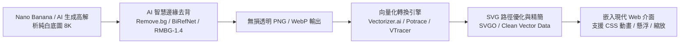
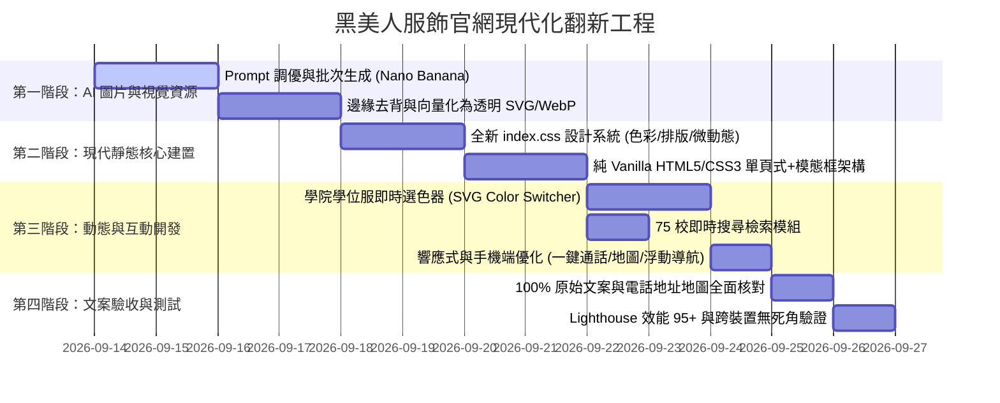

# 黑美人服飾開發有限公司 — 官方網站全面翻新改版企劃書

> **專案代號**：Project Black A Beauty Modernization  
> **目標**：將 20~30 年歷史的傳統 FrontPage/PhotoImpact 切圖靜態網站，全面升級為兼具現代頂級學術尊榮感、極致動態視覺效果、以及 100% 保留原始文案與品牌歷史底蘊的現代化純靜態官方網站。

---

## 目錄
1. [現況診斷與翻新目標](#一現況診斷與翻新目標)
2. [舊照片分析與 Nano Banana 現代專業攝影 Prompt 庫](#二舊照片分析與-nano-banana-現代專業攝影-prompt-庫)
   - [2.1 舊照片痛點與現代生成風格定位](#21-舊照片痛點與現代生成風格定位)
   - [2.2 AI Prompt 結構設計與渲染參數標準](#22-ai-prompt-結構設計與渲染參數標準)
   - [2.3 碩博士服與各產品逐項 Prompt 清單](#23-碩博士服與各產品逐項-prompt-清單)
   - [2.4 圖片轉背景透明 SVG 向量工作流程](#24-圖片轉背景透明-svg-向量工作流程)
3. [現代風格靜態網站設計系統與動態體驗規範](#三現代風格靜態網站設計系統與動態體驗規範)
   - [3.1 設計語言：學術尊榮典雅奢華（Academic Prestige & Modern Luxury）](#31-設計語言學術尊榮典雅奢華academic-prestige--modern-luxury)
   - [3.2 色彩系統（Color System）](#32-色彩系統color-system)
   - [3.3 字體排印（Typography）](#33-字體排印typography)
   - [3.4 核心視覺與動態特效（Interactive & Motion UX）](#34-核心視覺與動態特效interactive--motion-ux)
   - [3.5 現代化功能模組設計](#35-現代化功能模組設計)
4. [原始文案與店家資訊 100% 完整保留清單](#四原始文案與店家資訊-100-完整保留清單)
   - [4.1 商家資訊與聯絡通道](#41-商家資訊與聯絡通道)
   - [4.2 服務優勢與品質承諾文案](#42-服務優勢與品質承諾文案)
   - [4.3 75 所合作大專院校名單（升級為互動檢索系統）](#43-75-所合作大專院校名單升級為互動檢索系統)
   - [4.4 規格與服務品項表格](#44-規格與服務品項表格)
   - [4.5 周邊特殊服裝清單](#45-周邊特殊服裝清單)
5. [實施步驟與分期排程（Roadmap）](#五實施步驟與分期排程roadmap)

---

## 一、現況診斷與翻新目標

### 1.1 現況診斷
* **架構風格**：典型 1990 年代末至 2000 年代初的 FrontPage/PhotoImpact 切圖排版，大量使用 `<table>` 進行多層嵌套，外帶大理石花紋平鋪背景 (`BackGround - 01.gif`)、立體浮雕按鈕 (`Button - *.gif`) 與文字圖檔。
* **圖片品質**：
  * 學士服、碩士服、博士服照片尺寸僅 200~240 像素，色彩飽和度不足、受制於早期數位相機的低動態範圍。
  * 拍攝方式為早期人台放置於皺褶白布前，搭配強烈正面閃光燈造成強烈陰影與反光，缺乏高級布料紋理（絲絨、天鵝絨、高密毛呢、光澤緞面）的細節展現。
  * 部分頁面插入了與服裝完全無關的風景裝飾圖（如櫻花、日式庭園傘、甚至烘焙坊麵包圖樣），削弱了專業製服的品牌說服力。
* **優點與珍貴資產**：
  * 擁有**逾 75 所大專院校**合作口碑、直營工廠一貫化作業、承製國內外博士服客製的強大工藝能力。
  * 完整的通訊地址、電話、FB、Yahoo 拍賣、Blogger 與 Google 地圖。

### 1.2 翻新目標
1. **視覺奢華化**：擺脫「陳舊廉價工廠」印象，轉型為「三十年學術禮袍名家、頂尖名校指定御用」的尊榮工坊形象。
2. **資產現代化**：以現代專業商業時尚棚拍（Invisible Ghost Mannequin / Editorial Lighting）重塑全系列學位服，並轉成乾淨透明背景的 SVG/向量與高畫質 WebP 資源。
3. **動態驚豔感**：採用微互動、懸浮光影（Glassmorphism）、布料光澤感動畫、學院學位服即時選色互動切換、以及 75 校快速即時搜尋器，讓使用者流暢瀏覽。
4. **文案零遺漏**：嚴格保留既有全部商業資訊、地址電話、各學院規格說明與院校名錄。

---

## 二、舊照片分析與 Nano Banana 現代專業攝影 Prompt 庫

### 2.1 舊照片痛點與現代生成風格定位
* **舊照風格**：黑頭假人模特、皺褶布幕背景、閃光燈死白反光、嚴重雜訊色階壓縮。
* **現代專業風格（Target Style）**：
  * **展示手法**：現代服裝專題常採用的 **隱形人台（Ghost Invisible Mannequin）** 或 **現代高雅模特兒工作室時裝棚拍（Editorial Fashion Studio）**。
  * **光質**：柔光箱（Softbox）、輪廓光（Rim Light）突顯披肩天鵝絨（Velvet）與高織緞面（Silk Satin）的精緻光澤與垂墜感。
  * **構圖**：正面無死角 3D 立體感、乾淨純色隔離背景，便於直接一鍵去背轉向量透明 SVG。

---

### 2.2 AI Prompt 結構設計與單眼棚拍參數標準

為徹底杜絕 AI 生成出「扁平向量圖、2D 插畫、卡通繪圖感」，Prompt 必須導入**頂級商業單眼攝影光學語法**，並以**真實棚拍打光與微距布料材質**錨定物理真實度：

```
[攝影器材與光學: Commercial product photography shot on Hasselblad H6D-100c medium format camera, 85mm f/5.6 prime lens, 1/160s, ISO 100, tack-sharp focus] + 
[主題與展示形式: Taiwanese university academic gown, displayed on a high-end 3D ghost mannequin with hollow neck depth OR luxury dark tailor dummy] + 
[真實布料物理紋理: Heavyweight matte black polyester gabardine with tactile micro woven texture, real sewing seams, natural gravity drape folds, genuine lustrous silk satin stole with authentic specular reflection] + 
[商業棚拍佈光與真實陰影: Profoto studio lighting, dual large octabox softboxes, soft rim lighting accentuating fabric edge, gentle contact shadow on floor grounding the garment in 3D space] + 
[背景控制: Seamless neutral off-white commercial studio cyclorama backdrop, clean photographic staging] + 
[負向提示 Negative Prompts: illustration, drawing, 2d, vector, vector graphics, cartoon, painting, digital art, cgi, 3d render, flat, clip art, anime, plastic, fake fabric, text, watermark, blurry]
```

---

### 2.3 碩博士服與各產品逐項 Prompt 清單

針對本站現存的所有照片，設計專屬真實商業單眼攝影 Prompt：

#### 【學士服系列】

##### 1. `Photo - Bachelor - 01.gif`（西式學士服 - 白/銀灰色領巾）
* **舊照特徵**：黑色學士袍、倒 V 型銀白緞面披肩領巾、白色四方帽帽穗。
* **Nano Banana / AI 頂級單眼商業實拍 Prompt（推薦版 - 隱形人台電商棚拍）**：
  > **Prompt (English)**:  
  > `Authentic commercial apparel photography of a modern Taiwanese university bachelor graduation gown, shot on Hasselblad H6D-100c medium format camera with 85mm f/5.6 prime lens. Displayed on a 3D invisible ghost mannequin revealing the hollow inside collar with dark lining. Heavyweight matte black polyester gabardine robe with realistic woven textile grain, visible sewing seams, shoulder gathers, and natural gravity-draped fabric folds. Crisp V-shaped collar stole tailored from genuine lustrous silver-white silk satin resting naturally over the chest, displaying true specular light reflection and soft silk sheen. Black rigid mortarboard graduation cap resting naturally above on a clear acrylic display stand, featuring a silky pure white tassel with fine individually visible dangling threads. Professional Profoto studio lighting, dual softbox key lights from 45 degrees, subtle rim light highlighting garment contours, soft natural contact shadow underneath grounding the gown. Ultra-realistic, 8k resolution, raw photo quality, tack-sharp focus across all textures, seamless clean off-white studio backdrop.`  
  > **中文意圖**：哈蘇中片幅 85mm 鏡頭真實單眼棚拍，隱形人台展現領口內襯深度與 3D 空間感。純黑高密抗皺毛呢/斜紋布料，真實車縫線與自然垂墜重力褶皺；銀白色真絲緞面 V 領呈現真實光澤；黑色四方帽配個別絲線分明的純白流蘇。Profoto 專業柔光箱打光、真實輪廓光與地面柔和接觸陰影，徹底展現奢華成衣型錄質感。
* **必填負向提示詞（Negative Prompt）**：
  > `illustration, drawing, 2d, vector, vector graphics, cartoon, painting, sketch, digital render, CGI, 3d render, flat, clip art, anime, cel-shaded, canvas texture, plastic, artificial, oversaturated, blurry, bad lighting, watermark, text, logo, dummy face, plastic mannequin head`
* **備用風格（高級訂製工坊裁縫人台版 - Bespoke Tailor Mannequin）**：
  > `Editorial commercial studio photograph of a Taiwanese bachelor graduation gown, displayed on a high-end charcoal grey linen tailor dummy bust with a sleek dark mahogany wood and matte black metal floor stand. Deep matte black flowing academic robe with authentic woven fabric weave, brilliant silver-white silk satin V-neck stole with rich sheen, black academic mortarboard cap placed neatly on top. Professional studio photography, 85mm lens, f/8 aperture, soft directional studio flash, natural ambient contact shadows, luxury bespoke atelier look, 8k ultra-detailed.`

##### 2. `Photo - Bachelor - 02.gif`（學士服 - 水藍/寶藍色領巾、綠帽穗）
* **舊照特徵**：黑色學士袍、寶藍色亮面緞面領巾、鮮綠色帽穗（理工/工學院代表）。
* **Nano Banana 專業 Prompt**：
  > **Prompt (English)**:  
  > `Commercial studio product photography of an authentic Taiwanese university bachelor graduation gown, shot on Canon EOS R5 with 85mm f/5.6 lens. Displayed on a 3D ghost mannequin with hollow neck opening. Deep charcoal-black tailored academic gown with natural fabric folds and tactile woven texture, vibrant royal blue silk satin V-shaped stole collar with realistic glossy sheen, black mortarboard cap with a luxurious emerald-green silk tassel. Profoto studio lighting with soft rim illumination, subtle contact shadow on seamless neutral studio floor, raw photo, ultra-realistic, 8k, tack-sharp focus.`  
  > **中文意圖**：單眼相機棚拍學士袍，皇家藍真絲緞面 V 領領巾，祖母綠絲質帽穗，真實布料紋理與微距車線，自然接觸陰影。

##### 3. `Photo - Bachelor - 03.gif`（學士服 - 橘黃/金色領巾、紅帽穗）
* **舊照特徵**：黑色學士袍、亮橘金色領巾、紅白雙色帽穗（農學院/工程相關）。
* **Nano Banana 專業 Prompt**：
  > **Prompt (English)**:  
  > `Commercial catalog studio apparel photograph of an official bachelor graduation gown, shot on Sony A7R V with 90mm macro lens, f/6.3. Ghost mannequin display showing 3D structural fit. Tailored obsidian-black heavy gabardine robe with shoulder pleats, radiant amber-orange silk satin V-stole with metallic luster highlights, black mortarboard cap above with a vibrant red silk tassel. Professional three-point studio lighting catching the authentic silk reflections, natural soft shadow underneath, 8k resolution, photorealistic, neutral grey-white studio backdrop.`  
  > **中文意圖**：微距單眼棚拍，琥珀橘金色緞面領巾光澤，紅色絲穗四方帽，真實成衣立體空間感。

##### 4. `Photo - Bachelor - 04.gif`（學士服 - 紫羅蘭色領巾、綠帽穗）
* **舊照特徵**：黑色學士袍、紫羅蘭/薰衣草紫緞面領巾、鮮綠色帽穗（文學院/法學院）。
* **Nano Banana 專業 Prompt**：
  > **Prompt (English)**:  
  > `Commercial studio photograph of a university bachelor regalia on an invisible ghost mannequin, shot on Hasselblad H6D-100c, 85mm f/5.6. Deep matte black graduation robe with fine cloth texture, elegant royal purple silk satin V-shaped stole hood with realistic specular highlights, black square mortarboard cap with a bright green silky tassel. Soft directional studio flash, natural ambient contact shadows on floor, photorealistic, 8k, seamless white studio backdrop.`  
  > **中文意圖**：高雅紫色緞面 V 領學士服，綠色帽穗，頂級啞光黑長袍，真實攝影棚光影。

##### 5. `Photo - Bachelor - 05.gif`（西式純白學士服）
* **舊照特徵**：純白俐落倒 V 雙層領台學士服、白色流蘇四方帽。
* **Nano Banana 專業 Prompt**：
  > **Prompt (English)**:  
  > `Commercial apparel studio photography of a modern Western-style bachelor graduation gown on a 3D ghost mannequin, shot on Canon EOS R5 with 85mm f/5.6 lens. Tailored black premium wool-blend robe with wide elegant sleeves, distinctive crisp pure white double-fold V-collar stole with fine cotton-silk weave, black academic cap with shimmering pure white tassel. Studio softbox lighting, authentic fabric drape, delicate contact shadow, photorealistic, 8k, seamless neutral studio backdrop.`  
  > **中文意圖**：現代西式純白雙層 V 領學士服，白流蘇四方帽，真實單眼攝影棚打光。

##### 6. `Photo - Bachelor - 06.gif`（中式立領學士服）
* **舊照特徵**：特色中式立領（Mandarin Collar）全黑學士服、正面隱藏拉鍊、全黑素雅剪裁。
* **Nano Banana 專業 Prompt**：
  > **Prompt (English)**:  
  > `Commercial fashion studio photograph of a modern Chinese-style academic bachelor robe on an invisible ghost mannequin, shot on Hasselblad 85mm lens. Distinct traditional mandarin standing collar, concealed center zipper front, structured shoulder line with flowing pleated wide sleeves in heavy deep black textile, classic black mortarboard cap with sleek black tassel. Studio lighting carving delicate fabric depth and micro woven grain, authentic soft ground shadow, photorealistic, 8k.`  
  > **中文意圖**：中式立領特色學士服，純黑高密布料，細膩微距車縫與自然懸垂。

---

#### 【碩士服系列】

##### 7. `Photo - Master - 01.gif`（金黃色碩士披肩 + 梅花花結胸扣）
* **舊照特徵**：碩士垂袖長袍、華麗金黃色緞面碩士披肩背後垂兜、胸前金屬梅花花結、金黃帽穗。
* **Nano Banana 專業 Prompt**：
  > **Prompt (English)**:  
  > `High-end commercial catalog photography of an official Master's degree graduation regalia, shot on Hasselblad H6D-100c with 85mm f/5.6 lens. Displayed on an invisible 3D ghost mannequin with hollow neck. Premium black master's robe with elongated oblong drape sleeves, magnificent golden-yellow silk satin master hood stole draped across shoulders with intricate folded lining, adorned with an ornate embossed golden plum blossom rosette brooch clasp at the center chest. Black mortarboard cap with luxuriant golden-yellow tassel positioned neatly above. Dramatic studio rim lighting highlighting the golden sheen of silk, authentic fabric drape, subtle contact shadow, raw photo, 8k, seamless neutral off-white studio backdrop.`  
  > **中文意圖**：正式碩士服禮袍，長型碩士垂袖，耀眼金黃色真絲緞面碩士披肩，胸前金色立體梅花胸扣，金黃帽穗，展現高階碩士尊榮感。

##### 8. `Photo - Master - 02.gif`（艷紫色碩士披肩 + 梅花花結胸扣）
* **舊照特徵**：碩士垂袖長袍、深紫色緞面披肩、胸前金色梅花扣、紫色帽穗。
* **Nano Banana 專業 Prompt**：
  > **Prompt (English)**:  
  > `Commercial studio regalia photography of a Master's degree graduation gown on a 3D ghost mannequin, shot on Canon EOS R5 with 85mm f/5.6 lens. Deep black master robe with traditional hanging arc-shaped sleeves, opulent magenta-purple silk satin hood lining with gold accent piping, fastened with an embossed golden plum flower rosette clasp on the sternum. Black cap with vivid purple silk tassel. Elegant velvet-like micro textures, soft directional studio lighting, delicate floor contact shadow, 8k resolution, raw photo quality, neutral grey-white studio backdrop.`  
  > **中文意圖**：高貴紫紅緞面碩士披肩，金色梅花胸扣，紫色流蘇，真實布料質感與攝影棚微影。

---

#### 【博士服系列】

##### 9. `Photo - Doctor - 01.gif`（象牙白博士披肩 + 三道天鵝絨袖槓）
* **舊照特徵**：全套博士袍、胸前兩道黑色天鵝絨門襟、袖子三道黑色天鵝絨橫條槓（Chevrons）、純白緞面披肩、金色梅花扣、白帽穗。
* **Nano Banana 專業 Prompt**：
  > **Prompt (English)**:  
  > `Commercial apparel studio photograph of prestigious doctoral degree regalia on an invisible ghost mannequin, shot on Hasselblad H6D-100c, 85mm f/5.6. Full heavyweight black doctoral gown featuring plush black velvet front facings and three horizontal black velvet chevrons on each bell sleeve, elaborate ivory-white silk satin doctoral hood with gold rim piping and golden plum blossom chest clasp, black doctoral velvet tam cap with pure white tassel. Exquisite tactile textural contrast between matte wool, plush velvet, and shimmering silk satin. Studio editorial lighting, delicate contact shadow grounding the garment, 8k, raw photo, seamless cyclorama background.`  
  > **中文意圖**：最高等級博士袍，前襟黑色天鵝絨飾邊，鐘形袖三道黑色天鵝絨橫槓，象牙白絲緞博士披肩與金色梅花胸扣，白色帽穗，純白天鵝絨質感強烈。

##### 10. `Photo - Doctor - 02.gif`（皇家藍金邊博士披肩 + 天鵝絨飾邊）
* **舊照特徵**：博士長袍、天鵝絨飾邊、皇家藍配金黃色內襯博士披肩、金色梅花扣、藍色帽穗。
* **Nano Banana 專業 Prompt**：
  > **Prompt (English)**:  
  > `Commercial studio photograph of a doctoral academic gown ensemble on a 3D ghost mannequin, shot on Sony A7R V with 90mm lens. Premium black robe with rich black velvet lapels and triple sleeve velvet bars, magnificent doctoral hood in royal blue velvet and brilliant gold silk lining, fastened with a gilded flower rosette medallion, doctoral cap with royal blue silk tassel. Masterful studio lighting revealing rich fabric nap and glossy silk reflection, soft natural floor contact shadow, 8k, photorealistic, seamless neutral studio backdrop.`  
  > **中文意圖**：尊榮皇家藍與金色內襯博士披肩，天鵝絨前襟與三袖槓，金色徽章扣，真實攝影棚光影。

##### 11. `Photo - Doctor - 03.gif`（美式名校哈佛紅博士服情境實拍）
* **舊照特徵**：兩位畢業生在紅磚大學校園交談，身著哈佛風格 Crimson 深紅/酒紅博士長袍，黑色天鵝絨門襟與三道黑天鵝絨袖槓，四方帽搭配金穗。
* **Nano Banana 專業 Prompt**：
  > **Prompt (English)**:  
  > `Modern lifestyle editorial graduation portrait of two distinguished Ph.D. graduates standing in front of a prestigious ivy league red brick university archway, bathed in warm cinematic afternoon sunlight. They wear iconic Harvard-crimson red doctoral gowns tailored from heavyweight gabardine, featuring rich black velvet front panels and three black velvet bars on the bell sleeves, wearing black velvet doctoral tams with gleaming metallic gold bullion tassels. Crisp 85mm lens portrait, shallow depth of field, joyful, prestigious, authentic graduation atmosphere, ultra-high resolution 8k.`  
  > **中文意圖**：名校紅磚建築前，兩位博士身著深緋紅/酒紅博士袍（黑天鵝絨門襟與三袖槓），頭戴黑天鵝絨博士軟帽配金流蘇，陽光灑落，氣質非凡。

##### 12. `Photo - Doctor - 04.gif`（雙人國外博士服棚拍/外景）
* **舊照特徵**：一男一女博士生，男士身穿黑長袍配藍天鵝絨門襟與三袖槓+八角帽；女士身穿黑袍天鵝絨門襟+藍天鵝絨圓頂軟帽（Tam）。
* **Nano Banana 專業 Prompt**：
  > **Prompt (English)**:  
  > `High-fashion studio graduation portrait of a male and female doctoral scholar standing side-by-side with confident smiles. The male wears a bespoke black doctoral gown with striking sapphire blue velvet front panels and triple blue sleeve bars, accompanied by an octagonal velvet tam with gold bullion tassel. The female wears an all-black luxury velvet-trimmed doctoral gown with a vibrant navy blue velvet doctoral beret tam. Clean modern minimalist grey-to-white gradient studio backdrop, high-end editorial lighting, ultra-realistic textiles and facial details, 8k.`  
  > **中文意圖**：現代專業攝影棚男女博士雙人形象照，男著寶藍天鵝絨飾邊博士袍配八角帽，女著純黑天鵝絨長袍配海軍藍軟帽，極致時尚雜誌質感。

##### 13. `Photo - Doctor - 05.gif` & `06.gif`（國際名校客製多元博士袍群像）
* **舊照特徵**：多國大學多元學位袍（包含紫袍、藍袍、紅黑雙色、多色學術兜帽），象徵「可訂製國內外各大學特定款式」。
* **Nano Banana 專業 Prompt**：
  > **Prompt (English)**:  
  > `Dynamic outdoor editorial shot of a multicultural group of four university doctorate graduates celebrating on a lush green campus lawn before historic stone architecture. Showcasing bespoke international academic regalia: one in crimson and black velvet, one in Oxford royal blue with scarlet stoles, one in regal imperial purple doctoral robe with black velvet chevrons, and another with emerald green silk academic hood. Joyful candid interaction, cinematic natural daylight, 8k ultra-detailed, showcasing custom tailoring craftsmanship.`  
  > **中文意圖**：多位畢業生穿著客製化國際學位袍（酒紅、牛津藍、帝國紫、翡翠綠學術兜帽），象徵黑美人服飾具備承接國內外任何大學客製化訂做之強大實力。

---

#### 【幼兒園博士服與周邊特殊服裝】

##### 14. `Photo - Children.gif`（幼稚園小博士服）
* **舊照特徵**：亮紅色貝雷軟帽、小紅領帶、白襯衫領、黑袍配紅色前胸與袖子紅色條紋。
* **Nano Banana 專業 Prompt**：
  > **Prompt (English)**:  
  > `Adorable and sharp product photography of a premium kindergarten graduation mini doctoral gown set on a child-sized invisible ghost mannequin, shot on Canon EOS R5 with 85mm lens. Scarlet red academic beret hat with red tassel, crisp white inner collar with a smart mini red tie, tailored black junior gown featuring bright red front center panel and three red chevrons on both sleeves. Vibrant colors, smooth tailored finish, studio lighting with soft contact shadow, raw photo, 8k, seamless clean studio backdrop.`  
  > **中文意圖**：幼稚園畢業生小博士服套裝，紅色軟貝雷帽、小領帶、黑底紅門襟與袖槓，童趣與榮耀感兼具，純白底去背。

##### 15. `Photo - OtherProduct.gif`（民俗表演服、鳳仙裝、功夫唐裝）
* **舊照特徵**：粉紅刺繡鳳仙裝、桃紅滾藍邊表演服、水藍短袖立領唐裝。
* **Nano Banana 專業 Prompt**：
  > **Prompt (English)**:  
  > `Commercial fashion product display of three traditional Taiwanese ceremonial and performance costumes on ghost mannequins side by side: left is a soft pastel pink satin Fengxian traditional blouse and skirt with delicate peony floral embroidery and gold trim; center is a vibrant magenta martial arts dance costume with cyan blue sash and borders; right is an ice-blue jacquard silk short-sleeve Kung-Fu shirt with mandarin collar and frog button closures. Studio crisp lighting, 8k, isolated on pure solid white background.`  
  > **中文意圖**：三套傳統表演與民俗服飾（粉紅牡丹刺繡鳳仙裝、桃紅舞蹈服、冰藍盤扣功夫唐裝），細緻光澤，純白底去背。

##### 16. `Photo - Theme.gif`（首頁四大主題禮袍綜合展示 Banner）
* **舊照特徵**：黑美人核心四款學位袍（學士、紅博士袍、藍博士袍、黑博士金邊白披肩）。
* **Nano Banana 專業 Prompt**：
  > **Prompt (English)**:  
  > `A panoramic luxury hero banner showcase of four prestigious academic regalia sets arranged in an elegant dynamic sequence on invisible mannequins: from left to right, a sleek modern Bachelor gown with silver stole, a magnificent Harvard-crimson Doctoral gown with black velvet facings, a royal blue custom European Doctoral gown with gold piping, and an opulent Master of Science black gown with golden-yellow silk hood and blossom brooch. Subtle dynamic ambient golden light particles, dark academic navy floating stage, ultra-luxurious, 8k panoramic composition.`  
  > **中文意圖**：四套核心學位袍（學士、酒紅博士、皇家藍博士、金黃碩士）的奢華全景橫幅展示，深色學術藍底座與香檳金流光。

---

### 2.4 圖片轉背景透明 SVG 向量工作流程

為了讓網站具備超高響應速度、無損縮放與輕量化，由 Nano Banana 生成的照片轉為透明 SVG 的標準步驟：



* **方案 A（極致向量圖模式）**：
  * 使用 `Vectorizer.ai` 或開源 `VTracer` 將透明 PNG 轉為分層色彩的向量 `.svg`。
  * 優點：檔案極小（50~150KB）、任意放大不模糊、可透過 CSS 針對披肩路徑（`<path class="hood">`）直接切換顏色！
* **方案 B（超高清寫實混合模式）**：
  * 背景透明的 WebP / AVIF 提供極致真實的布料絲綢天鵝絨照片細節，SVG 則封裝剪裁輪廓（Mask/Clip-Path）與向量裝飾邊框、梅花花結與大學徽章，兼顧極致逼真度與流暢動態。

---

## 三、現代風格靜態網站設計系統與動態體驗規範

### 3.1 設計語言：學術尊榮典雅奢華（Academic Prestige & Modern Luxury）
打破傳統政府機關/校園租借系統的呆板老舊感，採用常春藤盟校與高級訂製時裝品牌（Bespoke Atelier）的美學標準：
* **視覺基調**：深邃的學術海軍藍（Oxford Navy）搭配尊貴曜石黑（Obsidian），輔以象牙白（Ivory White）與香檳金（Champagne Gold）做為聚焦強調色。
* **材質感**：輕微毛玻璃擬物（Frosted Glassmorphism）、細緻邊框微光（Subtle Border Glow）、絲綢流動光澤漸變（Satin Gradient Shimmer）。

---

### 3.2 色彩系統（Color System）

```css
:root {
  /* 主背景與層次 */
  --bg-primary: #0A0E17;        /* 深邃學術午夜黑藍 */
  --bg-secondary: #111827;      /* 次級卡片背景 */
  --bg-elevated: #1F2937;       /* 浮起按鈕/彈窗背景 */
  --bg-glass: rgba(17, 24, 39, 0.75); /* 毛玻璃透明層 */

  /* 品牌重點色 */
  --accent-gold: #D4AF37;       /* 經典香檳金（榮耀/梅花扣/學位榮銜） */
  --accent-gold-light: #F3E5AB; /* 高光金色 */
  --accent-blue: #1D4ED8;       /* 皇家學術藍（理學院/碩士披肩） */
  --accent-crimson: #881337;    /* 尊榮博士酒紅（博士袍/文學院） */
  --accent-purple: #6B21A8;     /* 典雅紫羅蘭（法學/碩士款） */

  /* 文字階層 */
  --text-primary: #F9FAFB;      /* 純白標題 */
  --text-secondary: #9CA3AF;    /* 易讀次級灰色說明文案 */
  --text-muted: #6B7280;        /* 補充資訊與備註 */
  --border-subtle: rgba(212, 175, 55, 0.15); /* 金色微光外框 */
}
```

---

### 3.3 字體排印（Typography）
* **標題英文字體**：`Cinzel` / `Outfit` / `Playfair Display` —— 展現學位典禮百年莊重儀式感與頂級工藝感。
* **內文與中文排版**：`Noto Serif TC`（思源宋體，用於標題展現東方學人底蘊）+ `Noto Sans TC` / `Inter`（思源黑體，用於產品規格表格與說明，確保手機端極致清晰閱讀）。

---

### 3.4 核心視覺與動態特效（Interactive & Motion UX）

1. **Hero 首頁主視覺視差動態（Cinematic Hero）**：
   * 進入網頁時，四大代表袍服（學士/碩士/藍博士/紅博士）具備 3D 浮動效果與微微呼吸光影。
   * 背景有極淡雅的金粉浮動微粒子（Canvas / CSS Particles）與畢業季光環，瞬間創造「WOW」驚豔感。
2. **學位服「學院色即時互動試衣間」（Interactive Gown Color Switcher）**：
   * 允許使用者在學士服區點擊「文學院（白/灰）」、「工學院（藍）」、「農學院（橘）」、「理學院（紫）」、「中式立領」，SVG 學位服披肩會以流暢 CSS 漸變色彩平滑過渡切換！
3. **3D 卡片懸浮傾斜微互動（Tilt & Hover Glow）**：
   * 所有服裝展示卡片具備 3D 透視懸浮（`transform: perspective(1000px) rotateX(...)`），滑鼠滑過時產生金光掠影。
4. **75 所大學院校即時即打即找檢索器（Instant College Search & Filter）**：
   * 原始網站只有一段純文字列出 75 所學校，新版改為全前端即時搜尋引擎：
   * 具備「北部 / 中部 / 南部 / 東部 / 離島」地域標籤快速過濾，學生輸入「台大」、「清華」、「成大」即可即時點亮專屬合作合作徽章。
5. **租借與個人訂製流程時間軸（Interactive Service Timeline）**：
   * 步進式動畫展現「1. 諮詢選款 -> 2. 尺寸套量 -> 3. 工廠直送/專人送達 -> 4. 專業洗燙歸還」，清楚透明。
6. **全響應式流暢抽屜導航與一鍵通話浮動條（Mobile Sticky Action Bar）**：
   * 手機端瀏覽時，下方常駐「📞 一鍵通話 (07)3493832」、「💬 FB 官方諮詢」、「📍 導航到三民門市」快捷列。

---

## 四、原始文案與店家資訊 100% 完整保留清單

在全新網站架構中，所有既有文案將原汁原味收錄，並賦予精美現代化排版：

### 4.1 商家資訊與聯絡通道

| 項目 | 原始完整內容 | 現代網站呈現方式 |
| :--- | :--- | :--- |
| **公司全名** | 黑美人服飾開發有限公司 (Black A Beauty) | 頂部 Header Logo、Hero 標題與頁尾版權宣告 |
| **服務專線** | (07) 3493832、(07) 3597082、(07) 3597036 | 點擊撥打 `tel:` 連結，聯絡頁與頁尾醒目呈現 |
| **行動電話** | 0933-907-593 | 點擊撥打行動通話，行動端置底常駐按鈕 |
| **傳真號碼** | (07) 3104329、(07) 3426879 | 官方文件索取與報價單傳真區塊 |
| **官方信箱** | `yes_blackabeauty_yes@yahoo.com.tw` | `mailto:` 一鍵發信按鈕 |
| **實體門市地址** | 高雄市三民區鼎貴路62巷14號 | 結合互動 Google Maps 嵌入卡片，附導航按鈕 |
| **外部社群與賣場**| • 官網: `http://www.blackabeauty.com.tw`<br>• Facebook 粉絲頁<br>• Yahoo! 奇摩拍賣賣場<br>• 官方 Blogger: `http://blackabeauty999.blogspot.tw/` | 精緻 SVG 圖標外連按鈕，新分頁開啟 |

---

### 4.2 服務優勢與品質承諾文案

* **核心標語**：
  > 「本公司專營國內外各大學之博士、碩士、學士服」  
  > 「歡迎機關、團體『訂購、出租』」  
  > 「接受『個人訂製』國內外博士服、碩士服」
* **品質八大承諾（原汁原味）**：
  > **「直營工廠、一貫作業、專人設計、經驗豐富、物美價廉、品質保證、服務週到、專程送達」**  
  > *（新版將此八大核心提煉為專屬 8 大金牌保證卡片，搭配動態浮現效果）*
* **附設專業服務**：
  > 「【附設洗衣、訂製、出租】」

---

### 4.3 75 所合作大專院校名單（升級為互動檢索系統）

完全收錄原文中曾承製全國各大學院校（共 75 所大專院校並註明「正在增加中......」）：

> 清華大學、台北大學、輔仁大學、中正大學、中山大學、中原大學、成功大學、東吳大學、高雄大學、台灣海大、元智大學、文化學院、政治大學、台灣師大、高雄師大、新竹師大、崑山大學、輔英大學、虎尾學院、康寧學院、台北師大、台北商院、高雄應大、高雄科大、長榮大學、嘉南大學、南華大學、真理大學、屏東師大、屏東商院、屏東科大、北台學院、大仁大學、高醫大學、聖約翰大學、美和學院、中華大學、花蓮師大、東華大學、台中學院、環球學院、聯合大學、永達學院、立德大學、致遠學院、興國學院、德明學院、德霖學院、東南大學、實踐大學、景文學院、藝術大學、中洲學院、空中大學、東方學院、亞東學院、雲林科大、大葉大學、台北科大、樹德科大、南台大學、建國大學、醒吾大學、中台學院、中華醫院、南亞學院、南開學院、高苑大學、高雄海大、台灣體院、慈濟大學、澎湖海院、餐旅學院、大漢學院、高鳳大學。

---

### 4.4 規格與服務品項表格

保留原 `service.html` 中的經典報價與規格規範，以現代化高對比卡片呈現：

| 品名 | 規格 | 基本單位 | 服務備註 |
| :--- | :--- | :--- | :--- |
| **1. 博士服** | 含披肩、博士帽 | 1 套 | 提供機關團體／個人訂購、個人訂製、租賃服務 |
| **2. 碩士服** | 含披肩、碩士帽 | 1 套 | 提供機關團體／個人訂購、個人訂製、出租服務 |
| **3. 學士服** | 中式立領／西式領巾 | 1 套 | 各大學院各色領巾齊全、提供出租清洗服務 |

---

### 4.5 周邊特殊服裝清單

完全保留原 `other.html` 中的多元服飾承製項目：
> 「相關產品有運動服、團體服、學生制服、夾克、襯衫、合唱服、舞蹈服、帽子、休閒服、鳳仙裝、廣告背心、餐飲廚服、醫生袍、護士服、祭典禮服...等。歡迎來電詢問～！」

---

## 五、實施步驟與分期排程（Roadmap）



### 具體交付檔案清單（預期結構）
* `.design_notes/plan.md`（本企劃書）
* `index.html`（新版全新現代化首頁，整合學位服展示、試衣間、75校檢索、產品規格、品牌故事與聯絡方式）
* `css/style.css`（現代現代奢華學術風格樣式庫，支援深色模式與平滑微互動）
* `js/main.js`（互動過濾器、SVG 配色即時渲染、即時學校搜尋、視差與微動畫邏輯）
* `images/modern/`（由 Nano Banana 轉換之透明 SVG / WebP 高品質資產庫）

---
*本計劃書完畢，待確認後即可啟動實施。*
